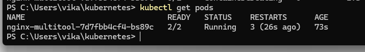
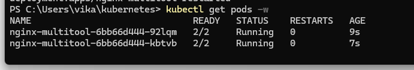
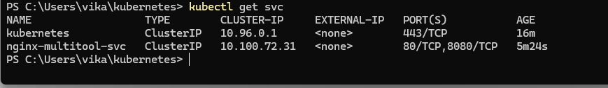
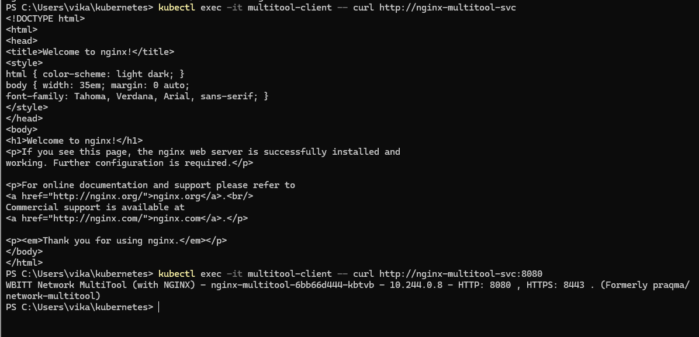
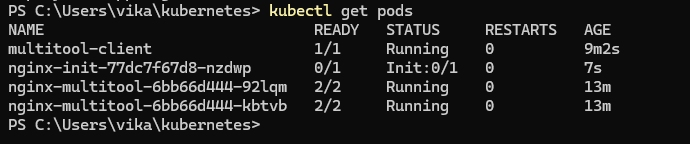
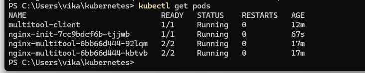

# Домашнее задание к занятию «Запуск приложений в K8S»
# Домашнее задание: Запуск приложений в K8S

## Задание 1. Deployment с nginx + multitool

### Манифесты
- [deployment-nginx-multitool.yaml](deployment-nginx-multitool.yaml)
- [service-nginx-multitool.yaml](service-nginx-multitool.yaml)

### Скриншоты

**Поды до масштабирования:**

**Поды после масштабирования:**

**Service:**

**Проверка через curl:**

---

## Задание 2. Init-контейнер

### Манифесты
- [deployment-nginx-init.yaml](deployment-nginx-init.yaml)
- [service-nginx-init.yaml](service-nginx-init.yaml)

### Скриншоты

**До создания Service (Init:0/1):**

**После создания Service (Running):**

